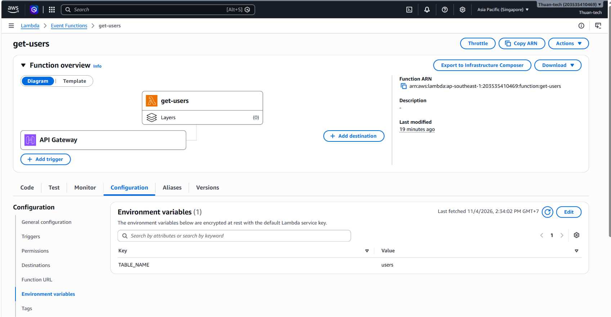
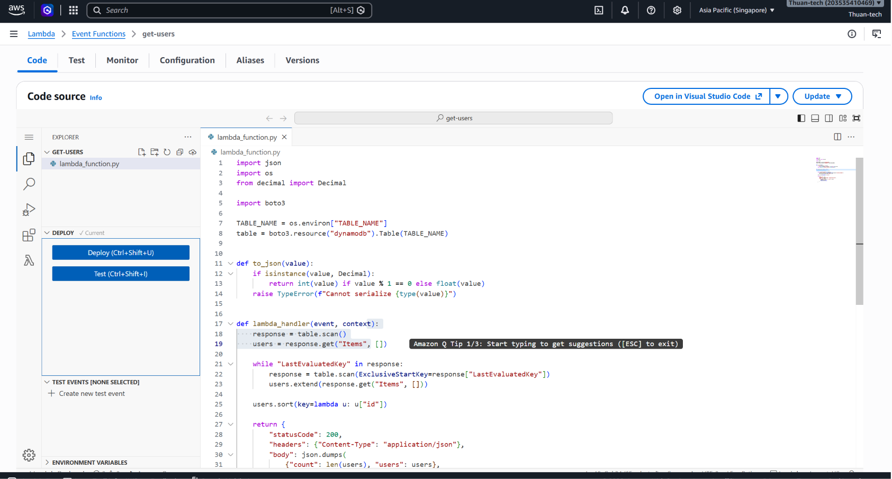
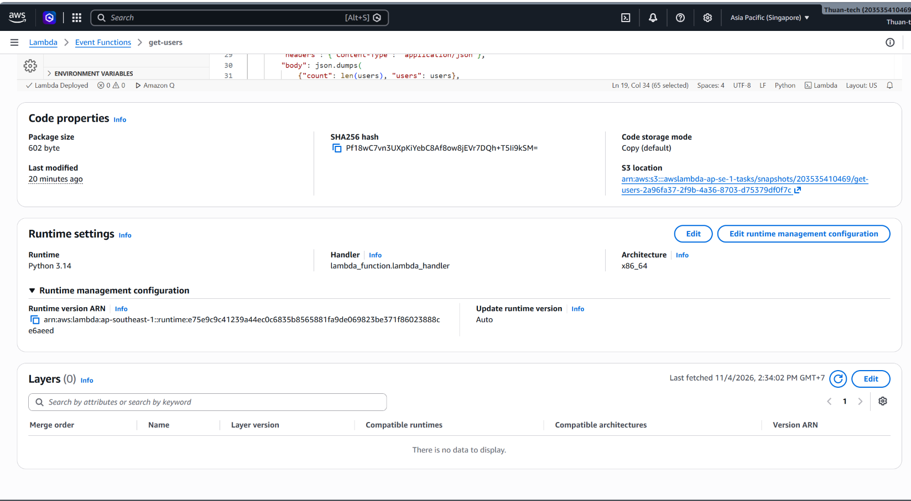
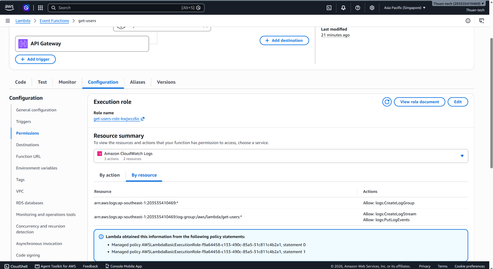
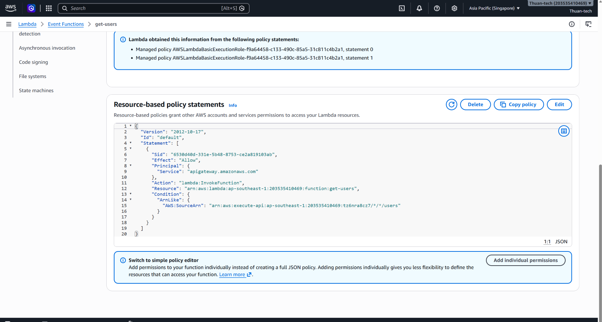
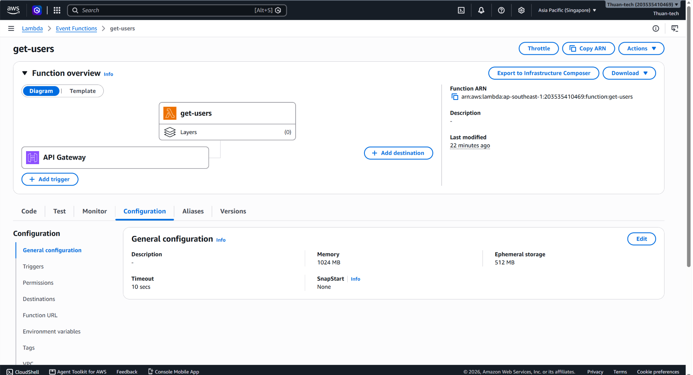
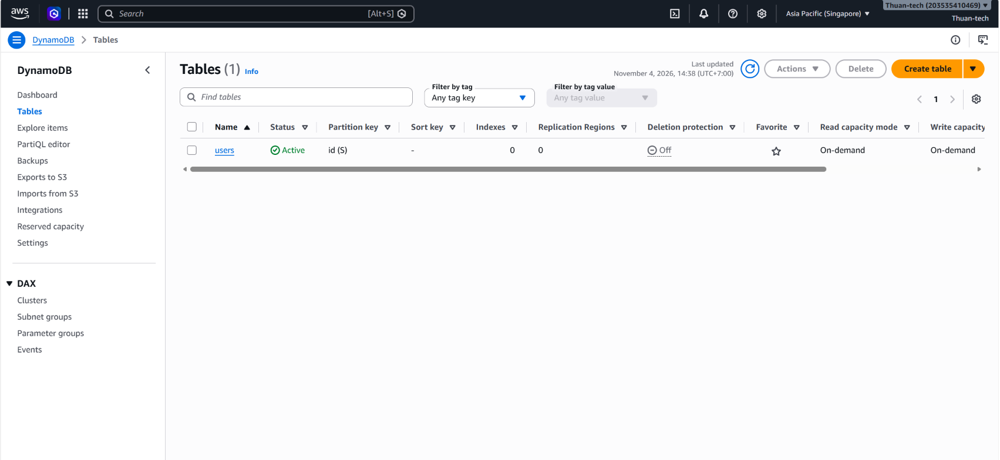
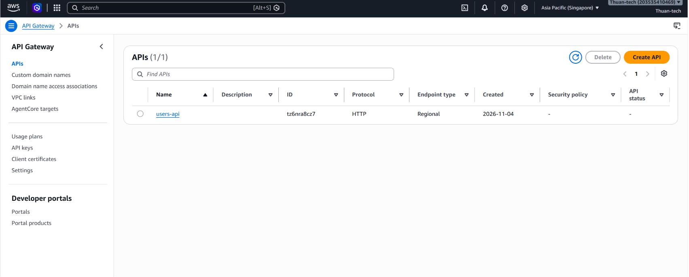
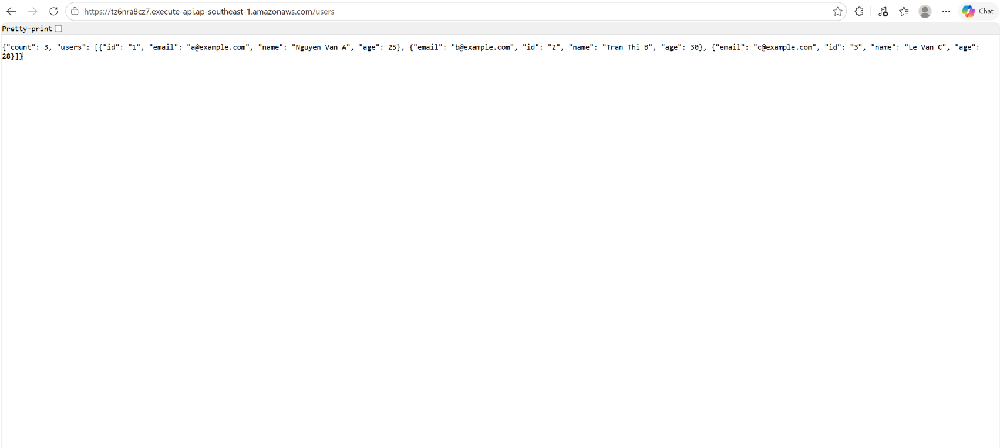

# Bài tập buổi 12 + 13 - Lambda + DynamoDB + API Gateway

## Đề bài

Deploy 1 dự án chạy Node.js hoặc Python có kết nối DynamoDB, đặt memory cho Lambda là 1GB.

Yêu cầu:
- Viết 1 API get users
- Gửi link API Gateway
- Screenshot: Lambda env, VS Code trong Lambda, handler, Lambda permissions

---

## Link API Gateway

https://tz6nra8cz7.execute-api.ap-southeast-1.amazonaws.com/users

Kết quả trả về:

```json
{
  "count": 3,
  "users": [
    { "id": "1", "name": "Nguyen Van A", "email": "a@example.com", "age": 25 },
    { "id": "2", "name": "Tran Thi B", "email": "b@example.com", "age": 30 },
    { "id": "3", "name": "Le Van C", "email": "c@example.com", "age": 28 }
  ]
}
```

---

## Kiến trúc

```
Trình duyệt
   │  GET /users
   ▼
API Gateway (HTTP API: users-api, stage $default)
   │  gọi Lambda
   ▼
Lambda get-users (Python 3.14, memory 1024 MB)
   │  boto3 scan bảng (quyền IAM chỉ đọc)
   ▼
DynamoDB (bảng users, partition key: id)
```

- **API Gateway** là cửa vào, nhận request `GET /users` từ Internet rồi chuyển cho Lambda.
- **Lambda** chạy code Python đọc dữ liệu trong DynamoDB, trả về JSON. Không cần server, có request mới chạy.
- **DynamoDB** lưu danh sách users, dạng NoSQL key-value.
- Tất cả đặt ở region `ap-southeast-1` (Singapore).

---

## Cấu hình

| Thành phần | Cấu hình |
|---|---|
| DynamoDB table | `users`, partition key `id` (String), on-demand |
| Lambda function | `get-users`, Python 3.14, x86_64 |
| Memory | 1024 MB (1GB) |
| Timeout | 10 giây |
| Handler | `lambda_function.lambda_handler` |
| Environment variable | `TABLE_NAME = users` |
| Execution role | Role mặc định (ghi log CloudWatch) + inline policy `read-users-table` (chỉ đọc bảng `users`) |
| API Gateway | HTTP API `users-api`, route `GET /users`, stage `$default` (auto-deploy) |

---

## Code

File [`lambda_function.py`](lambda_function.py):

- Tên bảng lấy từ biến môi trường `TABLE_NAME`, không ghi cứng trong code.
- Dùng `boto3` (có sẵn trong Lambda) để `scan` bảng, có xử lý phân trang nếu bảng lớn.
- DynamoDB trả số dạng `Decimal` nên phải đổi sang `int`/`float` trước khi chuyển thành JSON.
- Trả về theo format API Gateway cần: `statusCode`, `headers`, `body`.

Policy cấp quyền cho Lambda đọc DynamoDB: [`iam-policy.json`](iam-policy.json). Chỉ cho phép `Scan`, `GetItem`, `Query` trên đúng bảng `users`, không cho ghi/xóa, không đụng bảng khác (least privilege).

---

## Các bước làm

1. Tạo bảng DynamoDB `users`, partition key `id`, thêm 3 item mẫu.
2. Tạo Lambda `get-users` (Python, Author from scratch), để Lambda tự tạo execution role mặc định.
3. Dán code vào `lambda_function.py` trong editor của Lambda, bấm **Deploy**.
4. Configuration → General configuration: Memory **1024 MB**, Timeout **10s**.
5. Configuration → Environment variables: thêm `TABLE_NAME = users`.
6. Configuration → Permissions: vào execution role trên IAM, thêm inline policy chỉ cho đọc bảng `users`.
7. Test Lambda với event `{}`, ra `statusCode 200` và 3 users.
8. Tạo HTTP API trên API Gateway: integration là Lambda `get-users`, route `GET /users`, stage `$default`. API Gateway tự thêm quyền gọi Lambda (resource-based policy).
9. Mở Invoke URL + `/users` để kiểm tra.

---

## Minh chứng

### 1. Lambda env


### 2. VS Code trong Lambda


### 3. Handler


### 4. Lambda permissions




### 5. Memory 1GB


### 6. Bảng DynamoDB


### 7. API Gateway route


### 8. Kết quả gọi API


---

## Ghi chú

- Dùng `scan` vì bài chỉ cần lấy toàn bộ users và bảng nhỏ. Bảng lớn thì nên dùng `query` theo key hoặc phân trang để đỡ tốn tiền và nhanh hơn.
- Lambda, DynamoDB (on-demand) và API Gateway đều tính tiền theo lượt gọi, không có request thì gần như không tốn tiền, nên em để link chạy luôn.
- Execution role chỉ được cấp quyền đọc đúng bảng `users`, không dùng `AmazonDynamoDBFullAccess` để tránh cấp quyền thừa.
